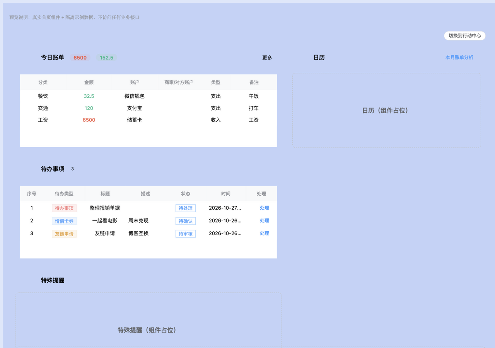
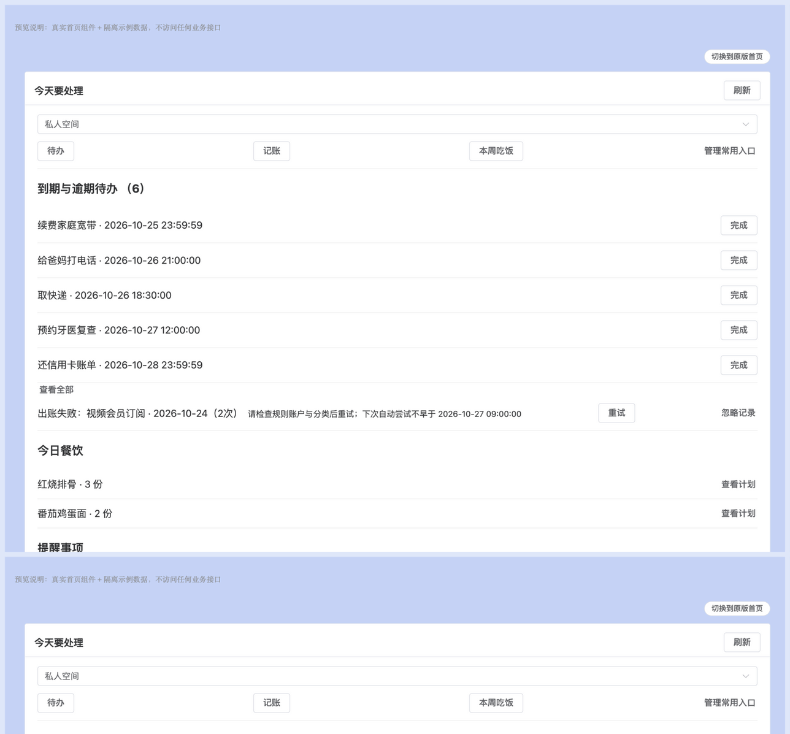
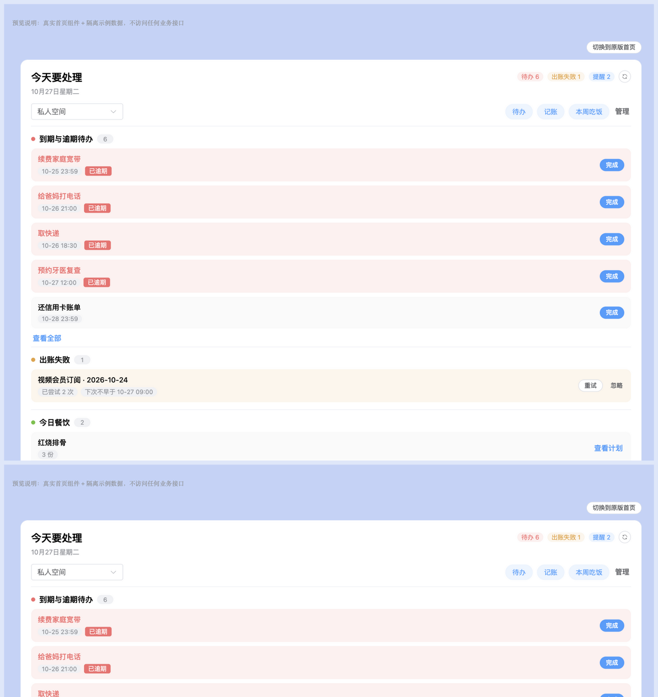
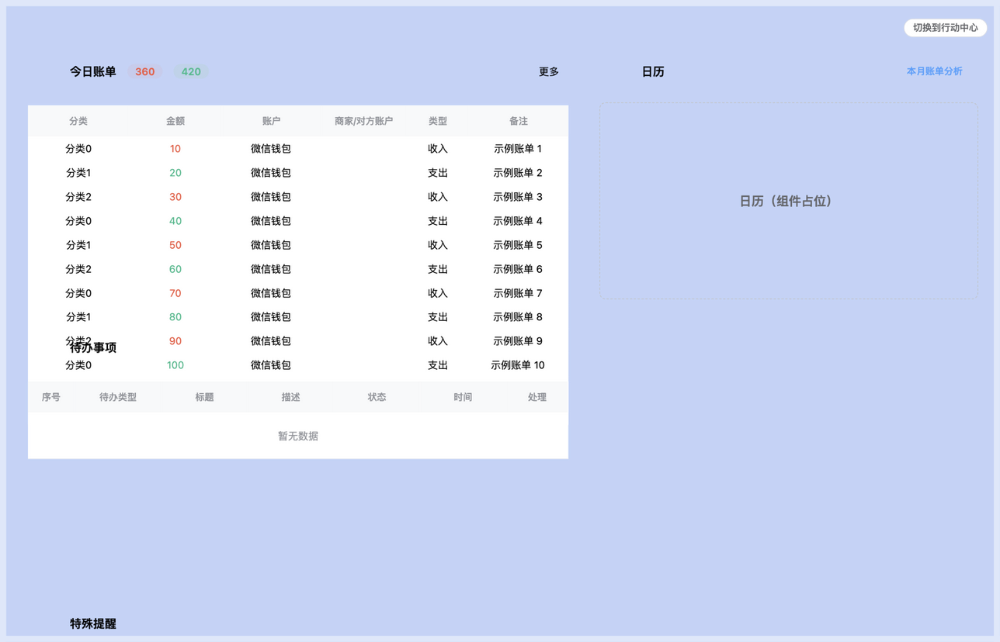
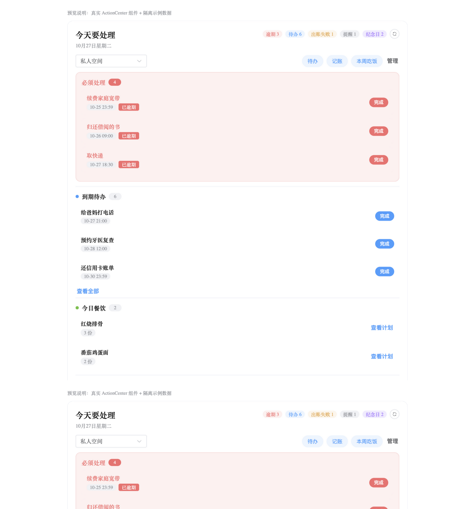
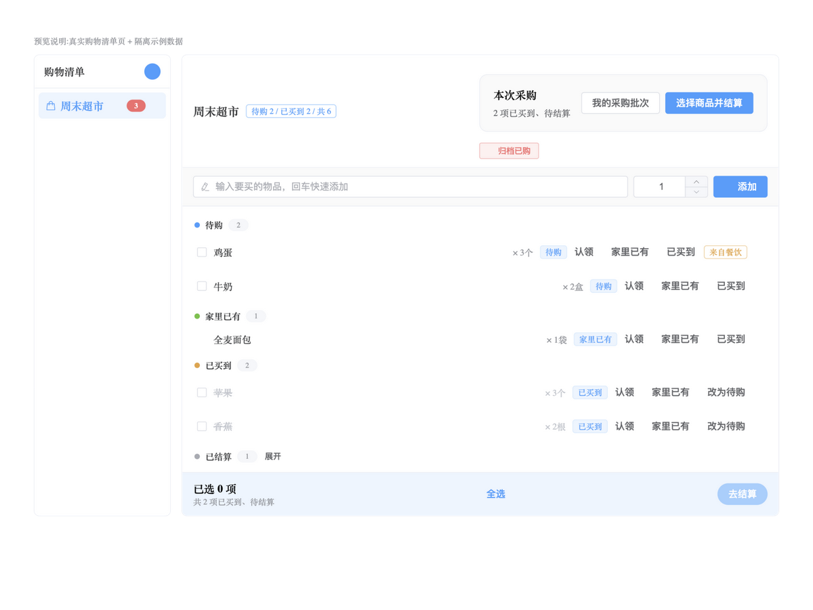
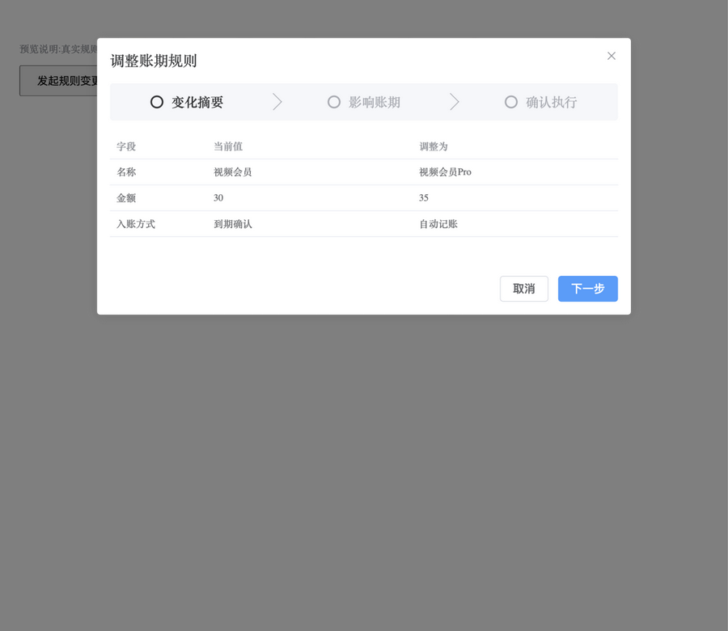

# UI / UE 优化与开发记录

更新：2026-10-24。本次检查操作计划列表、确认详情、执行反馈；直接调整已有 Vue 组件，沿用 Sky/Slate 颜色及 Element Plus 组件。截图来自本轮本地浏览器，使用真实组件和隔离的示例 API，不代表真实登录态验收。

## 1. 本轮发现与已落地调整

| 步骤 | 观察与影响 | 已落实 | 验证状态 |
|---|---|---|---|
| 1 找到要处理的计划 | 原列表将所有状态混排，标题、状态与按钮同等突出 | 全部/待处理/执行中/已结束筛选及数量、名称搜索、状态标签；按状态显示操作提示 | 浏览器已验证待处理筛选和名称搜索，Node 验证分类和关键词匹配 |
| 2 核对执行内容 | 原详情将正文与日期拼接成一行，新购物动作无法展示商品 | 步骤卡片、字段与值分列、目标清单、商品逐项展示；正文保留换行，长内容可滚动 | 浏览器核对目标清单、两项商品、日期、固定底部按钮 |
| 3 确认和重试 | 原按钮对所有执行阶段缺少区分；错误可能仅由全局消息提示 | 单一主要动作；执行中提供刷新进度/尝试恢复，失败提供重试未完成步骤；局部错误保留详情 | 示例确认后禁用重复动作，返回完成状态；真实幂等/回滚由 MySQL 集成测试覆盖 |
| 4 查看失败、空列表 | 原列表初次加载短暂显示空状态，详情加载失败缺少就地恢复 | 加载骨架/文字、筛选空态与无数据空态分开、加载失败保留已有列表、详情重试 | 构建及代码检查完成，慢网/断网完整浏览器验收待补 |

状态不能只靠颜色区分：标签始终保留文字；搜索有可访问名称；筛选可用键盘并标记选中状态；正文不通过 HTML 注入。PC 窄屏按钮换行，详情底部操作与可滚动正文分离。移动端同样提供筛选、搜索及字段预览，详情保留行内展开，按钮高度至少88rpx；App/小程序真机和屏幕阅读器尚未验收。

### 截图证据

1. 原列表：状态混排，处理优先级不明确。

2. 原详情：正文与日期拥挤，层级较弱。截图中的 shopping.add 为新场景测试数据，旧组件没有对应展示。

3. 优化后待处理列表：两项需处理内容集中显示。

4. 优化后确认详情：目标、商品、日期及主要操作清晰区分。

5. 重试后的结果：示例从部分完成变为已完成，显示2/2步骤完成。

## 2. 下一批 UI / UE 建议（尚未实施）

以下是基于当前功能结构的后续设计方向，并非已经完成的全站视觉审计；实施前需抓取各页面实际状态。

| 优先级 | 页面/流程 | 具体优化 | 开发验收标准 |
|---|---|---|---|
| P1 | 首页行动中心 | “今天必须处理 / 等待确认 / 最近完成”分层；只突出当前高优先级动作，次要模块折叠 | 不丢失原筛选和分页；同一事项处理后立即更新；各模块失败不阻塞其他模块 |
| P1 | 购物执行 | 底部显示已选数量及结算入口；分组显示待购/已买到；数量修改与状态动作分开 | 小屏可单手操作；已结算项目不被批量误选；提交前展示商品和总额 |
| P1 | AI 对话草稿 | 将纯文字草稿变成可编辑确认卡，显示目标、影响范围与计划状态，避免只靠输入“确认” | 编辑后重新预览；旧卡不能提交新内容；重复点击复用计划；输入失败保留草稿 |
| P2 | 共享空间 | 成员角色、可编辑范围和共享域摘要集中显示；把本人内容预览放到开启共享前的同一流程 | 明确现有/未来记录范围；不把预览当作逐条授权；退出后立即移除共享内容 |
| P2 | 账期与规则调整 | 将暂停/恢复/补齐拆成“变化摘要 → 影响账期 → 确认”短流程 | 保留手动/自动入账区分；只读账单信息不泄露；重复请求不重复入账 |
| P2 | 全局表单规范 | 统一必填项、就地校验、提交状态、空态、错误恢复、成功回执 | 失败时不关闭表单；操作按钮不跳位；禁用状态有说明；颜色不是唯一状态信息 |

## 3. 验证范围

后端166项、Node19项测试通过，失败/错误/跳过为0；PC/H5生产构建通过。浏览器操作仅使用本地示例数据，不访问生产记录。真实登录态全链路、移动端真机、键盘完整遍历、屏幕阅读器与暗色主题需补充验收。截图不能证明完整可访问性合规。

## 4. 第二批：采购结算（已实现）

1. **选择商品：通过。** 原界面仅显示数量，无法核对品名和数量；双端改为逐项勾选，显示已选数量，可一次选择最多200项。家里已有、待购、已结算条目不参与结算。浏览器验证两项中取消牛奶，只结算鸡蛋。
2. **可选记账：通过。** 开关与结算选择分区，关闭时不加载账户/分类、不发送残留财务字段；开启后展示实际金额、日期、账户、分类。未填金额时保留表单并就地提示。移动端真机未验收。
3. **提交与恢复：示例通过。** 提交期间锁定表单；成功后刷新采购数据，未选择商品保留；相同参数重试复用请求编号。批次加载失败与结算失败分开提示。服务端仍是已有结算事务，本次无后端修改。

新增6项前端测试，累计25项全部通过；PC/H5构建通过。测试覆盖双端实现一致性、可选商品范围、财务字段隔离、金额和日期校验、请求编号复用和上海业务日期。截图为真实组件配合本地模拟 API，不能证明实际账单写入；账户选择上限沿用现有接口每次100项，大量账户搜索仍待扩展。购物页顶部快捷分组及真正页面级底部工具栏仍待后续开发。

## 5. 第三批：行动中心交互可靠性

双端已落实加载中的状态说明、切换空间清除旧内容、重置列表展开状态，以及常用入口“编辑草稿→保存生效/取消”的流程。失败提示保留编辑选择；初始配置尚未加载时禁止开始编辑。本批以交互与异步状态修复为主，未重排首页整体布局；不新增视觉审计结论。

新增6项状态回归测试，累计31项通过；PC/H5构建通过。自动测试证明旧响应不会覆盖新空间状态；真实登录态共享空间切换、弱网及真机验收仍待补充。

## 6. 第四批：行动中心操作反馈

2026-10-25：完成待办、处理出账失败、处理提醒时，同一事项的相关按钮进入禁用状态，防止连续点击或同时执行相反操作。失败保留事项并显示可重试提示；提醒重试沿用原操作编号及稍后提醒时间。切换空间后不会显示上一空间操作的迟到错误。本批未调整首页视觉结构。

新增5项异步操作测试，前端累计36项通过；PC/H5构建通过。未做真实推送或真机验收。

## 7. 第五批：可编辑的创建草稿

2026-10-25：双端操作计划详情增加“修改草稿”。用户可以直接修正待办、笔记、日记、纪念日的单步创建内容，再保存并重新预览；无需重新输入整段聊天请求。编辑区明确提示旧草稿失效，编辑期间隐藏执行入口，保存后重新展示确认按钮。输入失败保留表单，取消修改恢复预览。

截图为真实PC组件与本地模拟API，已验证编辑期间执行入口隐藏、修改后内容展示正确且仍需确认。双端构建通过，前端累计39项测试通过，后端170项测试通过。移动端真机、弱网响应丢失恢复、聊天上下文关联仍待验收或完善。日期目前为格式明确的文本输入，日期选择器与编辑区固定保存工具栏是后续交互优化项；尚未实现聊天消息内编辑卡片。

## 8. 第六批：旧草稿到新预览的恢复入口

2026-10-25：旧草稿详情明确说明内容已修改，并增加“查看修改后的预览”。点击后加载新计划详情，继续显示核对与确认入口。相同保存请求在响应丢失后重试会返回同一新草稿，不重复创建；旧聊天确认明确指出须打开新预览核对。

浏览器已验证上述导航；截图为真实PC组件搭配模拟API。后端173项、前端39项测试通过，PC/H5构建通过。报告采纳关系同步、聊天内直接编辑卡片和日期选择器仍未包含在本批。

## 9. 第七批：报告行动状态与确认一致性

2026-10-25：报告行动从最新替换计划显示执行和待办完成状态，打开已有行动时使用当前计划内容。确认请求绑定弹窗刚展示的计划编号，多端修改后旧确认会被拒绝并要求重新预览。保留现有表单与确认弹窗布局，本批没有新增视觉审计或截图。后端175项、前端39项测试通过，PC/H5构建通过；真实登录态端到端验收待补。

## 10. 第八批：聊天内确认卡片

2026-10-25：PC聊天页、悬浮助手及移动端消息下方增加结构化确认卡。字段、状态和主操作集中显示；无需跳到计划列表即可修改支持的草稿。编辑时隐藏确认和刷新，保存后展示新内容等待确认；成功后隐藏写入按钮，只保留状态刷新。

浏览器截图为真实卡片组件置于模拟对话布局，使用模拟API；已验证卡片内修改、重新预览、确认后的完成反馈。完整聊天页与真实模型联调、App/小程序真机、页面级可访问性验收仍待补。后端176项、前端47项测试通过，PC/H5构建通过。日期选择器、原AI请求日志同步和聊天历史持久化未包含在本批。

## 11. 第九批：记账与待办变更的卡片字段

2026-10-26：AI 记账与待办修改/完成/删除进入持久化计划后，双端确认卡与计划详情沿用既有字段渲染通道，新增展示：记账草稿的收支类型、金额、分类、大类、账户、备注、支付时间；待办变更的目标清单（含“已完成”标记）与新内容。修改草稿编辑器开放记账的金额与备注两个字段，目标绑定不可编辑。本批为字段级扩展，未改变卡片布局与交互结构，未新增截图；工具文件双端字节一致由 Node 契约测试守护。后端194项、前端50项测试通过，PC/H5构建通过。

## 12. 第十批：内容发布草稿的确认卡

2026-10-26：内容发布迁移到持久化计划后，确认卡新增来源标题、文章标签与隐私警告字段（检测项逐项列出并提示敏感值已从生成上下文隐藏）；编辑器开放草稿标题、正文与标签。博客草稿在卡片与提示文案中固定标注“私有、未发布”。本批仍为字段级扩展，未新增截图；后端199项、前端52项测试通过，PC/H5构建通过。

## 13. 第十一批：聊天历史恢复

2026-10-26：双端聊天历史迁移到服务端后，PC 会话列表在刷新页面后恢复（标题取第一条用户消息前20字，切换会话按需加载），移动端进入页面自动恢复最近一次会话；“清空对话”同步清空服务端并开启新会话。恢复的消息按内容重新推导待确认状态，带计划编号的消息仍显示确认卡片。本批未改变消息气泡与输入区布局，未新增截图；后端203项、前端58项测试通过，PC/H5构建通过。PC 悬浮助手仍为页面内存，留待后续。

## 14. 第十二批：日期选择器

2026-10-26：补齐第7节遗留的日期选择器。双端计划草稿编辑器中，待办开始/截止时间使用日期时间选择器，日记与纪念日日期使用日期选择器（PC 为 Element Plus 组件，移动端为 uni-datetime-picker，与待办编辑页一致）；选择器产出原格式字符串，保存与校验流程不变，保存期间禁用选择。第七批的文本输入格式提示随选择器移除。未做浏览器/真机交互截图，待真机批次补充；前端59项测试通过，PC/H5构建通过，后端无改动。

## 15. 第十三批：首页双视图切换

2026-10-27：按用户要求把首页拆成“原版工作台”与“行动中心”两个视图，右上角一个切换按钮分别查看。此前行动中心叠加在原版仪表盘上方（见 [14-action-center-pc-default.png](ui-review/14-action-center-pc-default.png)、[15-action-center-pc-expanded.png](ui-review/15-action-center-pc-expanded.png)）。

- PC：内容区右上角“切换到行动中心 / 切换到原版首页”圆角按钮；原版视图保留完整工作台（今日账单、待办事项、特殊提醒、日历），行动中心视图只显示行动中心。原版容器用 v-show 保留，切换不重复请求。
- 移动端：问候栏右上角（搜索/通知铃铛旁）加“行动中心 / 原版”胶囊按钮；原版内容整体 v-show 隐藏，行动中心独占正文。
- 选择本地持久化（`pnkx-home-view`，默认原版），刷新后保持；功能开关关闭或未登录时不显示按钮且自动回落原版视图，避免空白首页（能力每30秒随既有机制刷新）。

浏览器以真实首页组件 + 桩子组件/API 验证：默认原版、点击切换、localStorage 持久化、刷新后保持行动中心、原版容器确认隐藏。

前端59项测试通过，PC/H5生产构建通过；后端与迁移无改动。移动端真机视图与切换手势未验收。

## 16. 第十四批：切换动画与行动中心视觉重构

2026-10-27：

1. **视图切换动画**：双端原版/行动中心切换时舞台容器按目标方向播放淡入位移动画（切向行动中心自下而上、切回原版自上而下，0.28s），两个状态使用不同动画名保证每次切换都重新播放；切换按钮悬停微抬升。行动中心卡片与各条目带错落入场动画（条目按序 30ms 递进），切回视图时整体重新入场。
2. **行动中心视觉重构**：标题区改为“今天要处理 + 日期副题 + 概要芯片（待办/出账失败/提醒计数）+ 圆形刷新”；常用入口改为彩色胶囊按钮；四个分区（待办/出账失败/餐饮/提醒）改为色点 + 标题 + 计数的分区头；条目从平铺列表改为圆角卡片，悬停微抬升带阴影；逾期待办红色底 + “已逾期”标签，截止时间缩略为“月-日 时:分”；出账失败为警示黄底；完成/重试为圆角主按钮。移动端同步重构（胶囊入口、色点分区、卡片条目、逾期标签），并把行动中心移到问候栏之后，动画与 PC 同节奏。

浏览器以真实组件验证：舞台动画类切换正确、概要芯片与逾期标签渲染、入场动画播放（截图为静态帧）。前端59项测试及 PC/H5 构建通过，后端无改动。移动端真机动画流畅度未验收。

## 17. 第十五批：原版视图去除内滚动条

2026-10-27：按用户要求，原版工作台不再出现卡片内滚动条。今日账单与待办事项表格移除 `height="100%"`（表格随内容自然增高，不再内部滚动）；布局移除视口推导的固定/最小高度（`dashboard-layout` 的 `calc(100vh-120px)`、特殊提醒卡的 `(100vh-84px)/4`），卡片主体 `overflow: auto → visible`。内容超出视口时由应用主区自然整页滚动，不再出现双滚动条。浏览器验证：注入 12 条账单后原版视图内可滚动元素数量为 0，页面级滚动正常。

PC/H5 构建通过（本批仅 PC 首页样式与模板属性调整）。

## 18. 第十六批：行动中心优先级分层与纪念日筹备接线

2026-10-27：完成第2节 P1 建议的分层，并把孤立的双端纪念日筹备组件接入首页。

1. **必须处理层**（置顶、浅红底圆角块、红色标题+计数）：逾期待办（红色卡片、红色"完成"按钮）与出账失败合并进入；两层内容都为空时整层隐藏——没有紧急事项时首页不再被空分区占据。
2. **到期待办**（蓝色）：仅未逾期项，分页与"查看全部"语义不变（逾期项在必须处理层展示）。
3. **未来30天纪念日准备**（紫色，新增接线）：此前后端聚合已返回 commemorations 桶但组件从未被任何页面引用；现接入双端行动中心，条目为紫色卡片（名称、发生日期、倒计时、准备状态标签），支持创建准备待办/忽略本次/重新准备，操作后刷新聚合。
4. **提醒事项**改为中性灰蓝点（次要确认类），今日餐饮保持绿色。概要芯片新增"逾期 N""纪念日 N"。

浏览器以真实组件验证：必须处理层、到期待办分区、纪念日条目均渲染；截图为静态帧。前端59项测试及 PC/H5 构建通过，后端无改动；移动端真机未验收。

## 19. 第十七批：购物执行分组与底部结算工具栏

2026-10-27：完成第2节 P1 的购物执行项（双端）。

1. **四分组显示**：购物条目按履约状态分组——待购（蓝）/ 家里已有（绿）/ 已买到（橙）/ 已结算（灰，默认折叠、可展开）；分组头带色点与计数，旧勾选数据按投影映射进待购/已买到。工具栏统计改为"待购 X / 已买到 Y / 共 Z"。
2. **底部结算工具栏**（受 shoppingPlanV2 开关控制）：已买到的条目可直接勾选，底部固定栏实时显示"已选 N 项 / 共 M 项已买到待结算"，支持全选/取消全选，"去结算"打开核对弹窗并带入页内预选（仅接受仍"已买到且未结算"的条目，已结算项不可选入）。功能关闭时回退旧勾选交互与"清空已勾选"底栏。
3. **动作分离**：状态动作（家里已有/已买到/改为待购/认领）集中在条目右侧链接区，与结算勾选、删除互不干扰；勾选切换后本地同步履约状态投影，分组即时生效。
4. 刷新或结算完成后自动修剪选择，仅保留仍符合条件的条目。

新增共享 `shoppingGroups.js`（双端字节一致）与 `useShoppingCheckout.open` 预选参数；浏览器以真实购物页验证分组渲染、已结算折叠入口、全选→去结算→弹窗"本次结算 2 项"预选链路。前端62项测试通过，PC/H5 构建通过；移动端真机未验收。

## 20. 第十八批：账期规则调整短流程

2026-10-27：完成第2节 P2 的"账期与规则调整"项（双端）。订阅/周期规则的变更与暂停补齐从"一段长文本确认框"改为**变化摘要 → 影响账期 → 确认执行**三步流程：

1. **变化摘要**：字段差异表格（当前值 → 调整为，含入账方式等枚举的中文释义）；同金额规则重复提示。补齐场景则展示将补齐的账期列表与每期金额。
2. **影响账期**：变更场景按来源实时拉取未入账账期（待确认/扣费失败，已入账自动过滤），明确"这些账期保留原金额快照，不受本次调整影响；新账期按新规则生成"；加载失败可重试、不阻塞后续确认。补齐场景展示账期去向（周期账单中逐期确认）。
3. **确认执行**：影响说明、15 分钟预览有效期提示；提交失败就地显示原因并提供"重新预览"。

组件挂载于订阅页与周期规则面板（双端共四处）；`changeRule/backfillRule` 调用签名与 Promise 语义不变（确认提交 resolve、取消 reject），调用点零改动；组件未挂载时自动降级为原有单条确认。共享 `ruleChangeFlow.js`（格式化 + 展示器注册，双端字节一致）。浏览器以真实组件 + 真实 API 模块验证三步内容、实例过滤与提交回执（截图因浏览器弹层表面采集不稳定仅保留第 1 步，其余以 DOM 断言覆盖）。前端65项测试及 PC/H5 构建通过；移动端真机未验收。

