# UI / UE 优化与开发记录

更新：2026-10-24。本次检查操作计划列表、确认详情、执行反馈；直接调整已有 Vue 组件，沿用 Sky/Slate 颜色及 Element Plus 组件。截图来自本轮本地浏览器，使用真实组件和隔离的示例 API，不代表真实登录态验收。

## 1. 本轮发现与已落地调整

| 步骤 | 观察与影响 | 已落实 | 验证状态 |
|---|---|---|---|
| 1 找到要处理的计划 | 原列表将所有状态混排，标题、状态与按钮同等突出 | 全部/待处理/执行中/已结束筛选及数量、名称搜索、状态标签；按状态显示操作提示 | 浏览器已验证待处理筛选和名称搜索，Node 验证分类和关键词匹配 |
| 2 核对执行内容 | 原详情将正文与日期拼接成一行，新购物动作无法展示商品 | 步骤卡片、字段与值分列、目标清单、商品逐项展示；正文保留换行，长内容可滚动 | 浏览器核对目标清单、两项商品、日期、固定底部按钮 |
| 3 确认和重试 | 原按钮对所有执行阶段缺少区分；错误可能仅由全局消息提示 | 单一主要动作；执行中提供刷新进度/尝试恢复，失败提供重试未完成步骤；局部错误保留详情 | 示例确认后禁用重复动作，返回完成状态；真实幂等/回滚由 MySQL 集成测试覆盖 |
| 4 查看失败、空列表 | 原列表初次加载短暂显示空状态，详情加载失败缺少就地恢复 | 加载骨架/文字、筛选空态与无数据空态分开、加载失败保留已有列表、详情重试 | 构建及代码检查完成，慢网/断网完整浏览器验收待补 |

状态不能只靠颜色区分：标签始终保留文字；搜索有可访问名称；筛选可用键盘并标记选中状态；正文不通过 HTML 注入。PC 窄屏按钮换行，详情底部操作与可滚动正文分离。移动端同样提供筛选、搜索及字段预览，详情保留行内展开，按钮高度至少88rpx；App/小程序真机和屏幕阅读器尚未验收。

### 截图证据

1. 原列表：状态混排，处理优先级不明确。

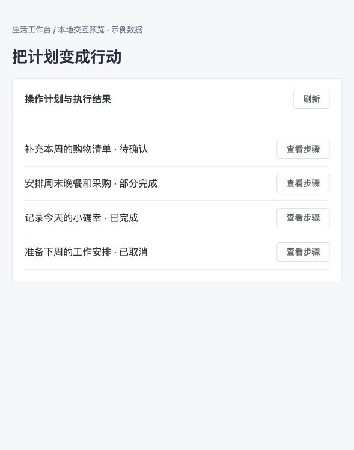

2. 原详情：正文与日期拥挤，层级较弱。截图中的 shopping.add 为新场景测试数据，旧组件没有对应展示。

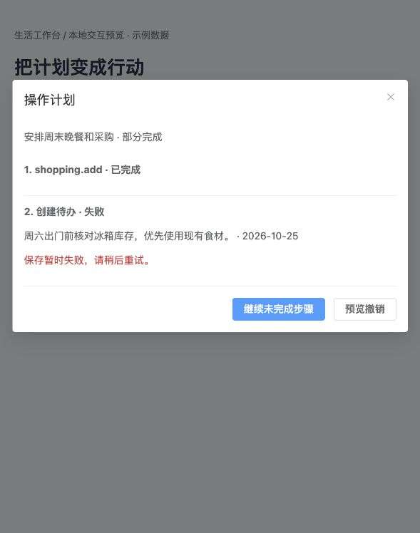

3. 优化后待处理列表：两项需处理内容集中显示。

4. 优化后确认详情：目标、商品、日期及主要操作清晰区分。

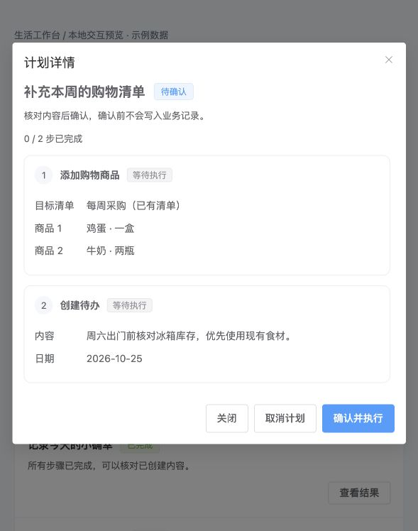

5. 重试后的结果：示例从部分完成变为已完成，显示2/2步骤完成。

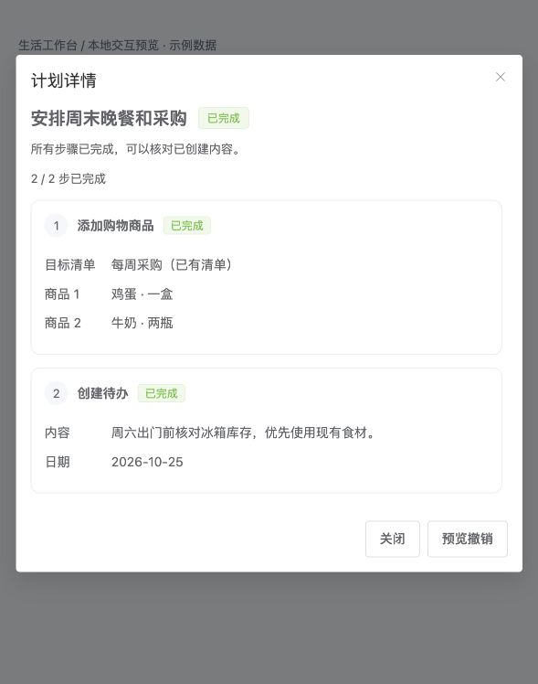

## 2. 下一批 UI / UE 建议（尚未实施）

以下是基于当前功能结构的后续设计方向，并非已经完成的全站视觉审计；实施前需抓取各页面实际状态。

| 优先级 | 页面/流程 | 具体优化 | 开发验收标准 |
|---|---|---|---|
| P1 | 首页行动中心 | “今天必须处理 / 等待确认 / 最近完成”分层；只突出当前高优先级动作，次要模块折叠 | 不丢失原筛选和分页；同一事项处理后立即更新；各模块失败不阻塞其他模块 |
| P1 | 购物执行 | 底部显示已选数量及结算入口；分组显示待购/已买到；数量修改与状态动作分开 | 小屏可单手操作；已结算项目不被批量误选；提交前展示商品和总额 |
| P1 | AI 对话草稿 | 将纯文字草稿变成可编辑确认卡，显示目标、影响范围与计划状态，避免只靠输入“确认” | 编辑后重新预览；旧卡不能提交新内容；重复点击复用计划；输入失败保留草稿 |
| P2 | 共享空间 | 成员角色、可编辑范围和共享域摘要集中显示；把本人内容预览放到开启共享前的同一流程 | 明确现有/未来记录范围；不把预览当作逐条授权；退出后立即移除共享内容 |
| P2 | 账期与规则调整 | 将暂停/恢复/补齐拆成“变化摘要 → 影响账期 → 确认”短流程 | 保留手动/自动入账区分；只读账单信息不泄露；重复请求不重复入账 |
| P2 | 全局表单规范 | 统一必填项、就地校验、提交状态、空态、错误恢复、成功回执 | 失败时不关闭表单；操作按钮不跳位；禁用状态有说明；颜色不是唯一状态信息 |

## 3. 验证范围

后端166项、Node19项测试通过，失败/错误/跳过为0；PC/H5生产构建通过。浏览器操作仅使用本地示例数据，不访问生产记录。真实登录态全链路、移动端真机、键盘完整遍历、屏幕阅读器与暗色主题需补充验收。截图不能证明完整可访问性合规。

## 4. 第二批：采购结算（已实现）

1. **选择商品：通过。** 原界面仅显示数量，无法核对品名和数量；双端改为逐项勾选，显示已选数量，可一次选择最多200项。家里已有、待购、已结算条目不参与结算。浏览器验证两项中取消牛奶，只结算鸡蛋。
2. **可选记账：通过。** 开关与结算选择分区，关闭时不加载账户/分类、不发送残留财务字段；开启后展示实际金额、日期、账户、分类。未填金额时保留表单并就地提示。移动端真机未验收。
3. **提交与恢复：示例通过。** 提交期间锁定表单；成功后刷新采购数据，未选择商品保留；相同参数重试复用请求编号。批次加载失败与结算失败分开提示。服务端仍是已有结算事务，本次无后端修改。

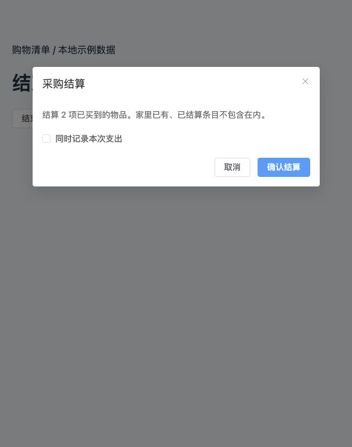

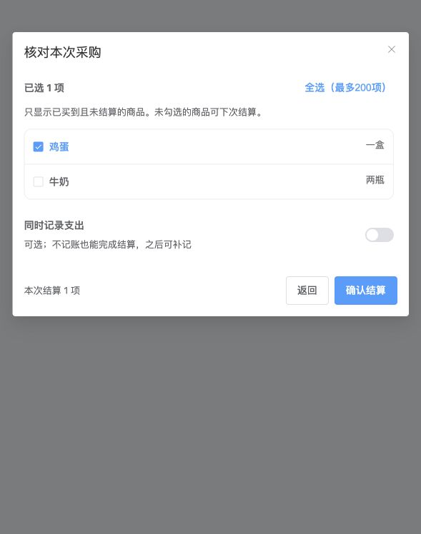

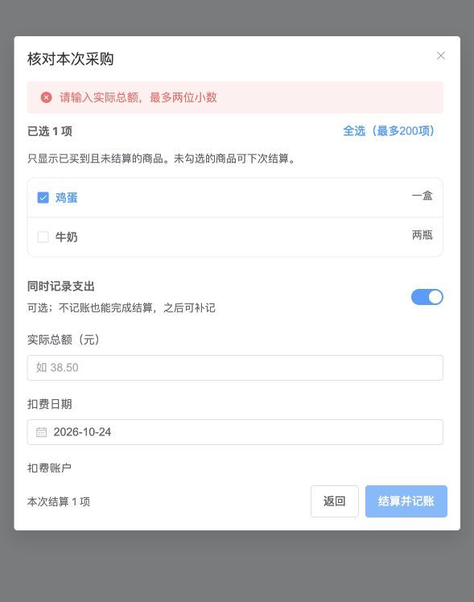

新增6项前端测试，累计25项全部通过；PC/H5构建通过。测试覆盖双端实现一致性、可选商品范围、财务字段隔离、金额和日期校验、请求编号复用和上海业务日期。截图为真实组件配合本地模拟 API，不能证明实际账单写入；账户选择上限沿用现有接口每次100项，大量账户搜索仍待扩展。购物页顶部快捷分组及真正页面级底部工具栏仍待后续开发。

## 5. 第三批：行动中心交互可靠性

双端已落实加载中的状态说明、切换空间清除旧内容、重置列表展开状态，以及常用入口“编辑草稿→保存生效/取消”的流程。失败提示保留编辑选择；初始配置尚未加载时禁止开始编辑。本批以交互与异步状态修复为主，未重排首页整体布局；不新增视觉审计结论。

新增6项状态回归测试，累计31项通过；PC/H5构建通过。自动测试证明旧响应不会覆盖新空间状态；真实登录态共享空间切换、弱网及真机验收仍待补充。

## 6. 第四批：行动中心操作反馈

2026-10-25：完成待办、处理出账失败、处理提醒时，同一事项的相关按钮进入禁用状态，防止连续点击或同时执行相反操作。失败保留事项并显示可重试提示；提醒重试沿用原操作编号及稍后提醒时间。切换空间后不会显示上一空间操作的迟到错误。本批未调整首页视觉结构。

新增5项异步操作测试，前端累计36项通过；PC/H5构建通过。未做真实推送或真机验收。

## 7. 第五批：可编辑的创建草稿

2026-10-25：双端操作计划详情增加“修改草稿”。用户可以直接修正待办、笔记、日记、纪念日的单步创建内容，再保存并重新预览；无需重新输入整段聊天请求。编辑区明确提示旧草稿失效，编辑期间隐藏执行入口，保存后重新展示确认按钮。输入失败保留表单，取消修改恢复预览。

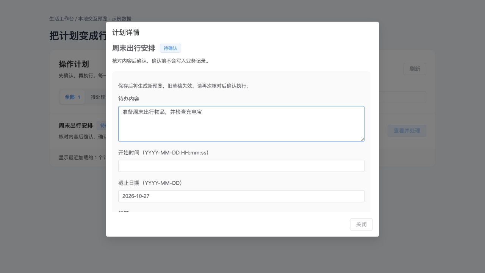

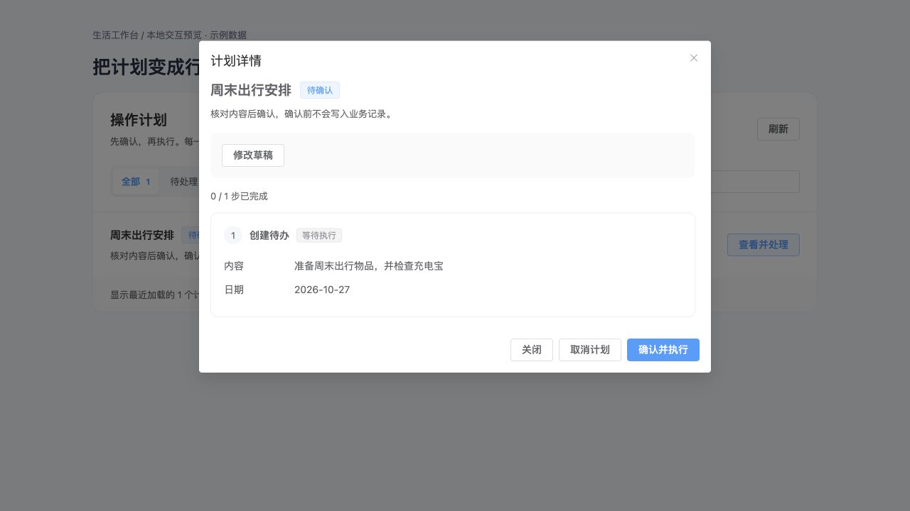

截图为真实PC组件与本地模拟API，已验证编辑期间执行入口隐藏、修改后内容展示正确且仍需确认。双端构建通过，前端累计39项测试通过，后端170项测试通过。移动端真机、弱网响应丢失恢复、聊天上下文关联仍待验收或完善。日期目前为格式明确的文本输入，日期选择器与编辑区固定保存工具栏是后续交互优化项；尚未实现聊天消息内编辑卡片。

## 8. 第六批：旧草稿到新预览的恢复入口

2026-10-25：旧草稿详情明确说明内容已修改，并增加“查看修改后的预览”。点击后加载新计划详情，继续显示核对与确认入口。相同保存请求在响应丢失后重试会返回同一新草稿，不重复创建；旧聊天确认明确指出须打开新预览核对。

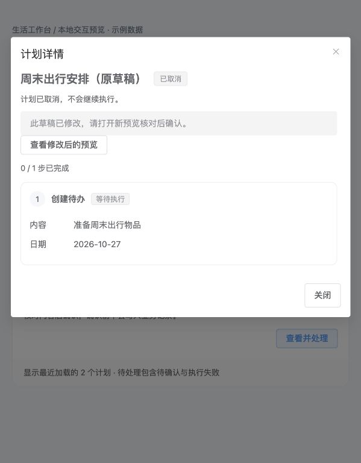

浏览器已验证上述导航；截图为真实PC组件搭配模拟API。后端173项、前端39项测试通过，PC/H5构建通过。报告采纳关系同步、聊天内直接编辑卡片和日期选择器仍未包含在本批。

## 9. 第七批：报告行动状态与确认一致性

2026-10-25：报告行动从最新替换计划显示执行和待办完成状态，打开已有行动时使用当前计划内容。确认请求绑定弹窗刚展示的计划编号，多端修改后旧确认会被拒绝并要求重新预览。保留现有表单与确认弹窗布局，本批没有新增视觉审计或截图。后端175项、前端39项测试通过，PC/H5构建通过；真实登录态端到端验收待补。

## 10. 第八批：聊天内确认卡片

2026-10-25：PC聊天页、悬浮助手及移动端消息下方增加结构化确认卡。字段、状态和主操作集中显示；无需跳到计划列表即可修改支持的草稿。编辑时隐藏确认和刷新，保存后展示新内容等待确认；成功后隐藏写入按钮，只保留状态刷新。

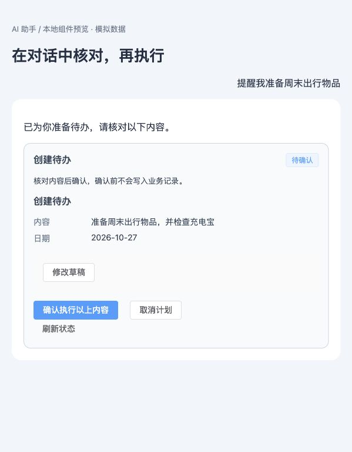

浏览器截图为真实卡片组件置于模拟对话布局，使用模拟API；已验证卡片内修改、重新预览、确认后的完成反馈。完整聊天页与真实模型联调、App/小程序真机、页面级可访问性验收仍待补。后端176项、前端47项测试通过，PC/H5构建通过。日期选择器、原AI请求日志同步和聊天历史持久化未包含在本批。
