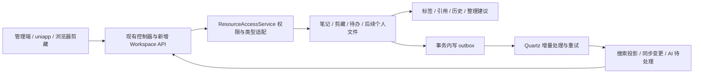

# Pnkx × LightNote：功能对比与落地技术方案

日期：2026-10-11。本文是代码分析与拟实施方案，不代表功能已经开发或通过运行验证。

分析基线：Pnkx 工作区 HEAD `e22739acd475e833d740b519c818f27d2d3fdd7b`；LightNote GitHub main 的取样提交 `f88002a7ce2de300801e67047e8c25d611e40480`。LightNote 通过 GitHub 目录树及固定提交的原始源码核查，未运行其在线服务。当前工作区已有的 `V1.6.3__web_article_cleanup_ghost.sql` 修改保留不动。

## 1. 结论与产品方向

Pnkx 已有比 LightNote 更广的生活管理能力：记账、预算、日记、纪念日、家庭日历、购物、菜谱、订阅、读书、多端及离线同步。LightNote 值得借鉴的是围绕资料的组织与使用闭环：统一标签 → 跨资源搜索 → 引用关联 → 整理建议 → 历史恢复。

建议将 Pnkx 演进为“个人生活 + 知识工作台”。优先把已存在的网址剪藏、笔记和待办连接起来，之后再接入个人文件。保留 Spring Boot/MyBatis/MySQL/Redis/Quartz、Vue 3/Element Plus/Vuex、Nuxt 和 uniapp 架构。

推荐首个交付场景：收藏一篇文章 → 放进“学习 Java”主题 → 引用到学习笔记 → 创建关联待办 → 从今日工作台继续处理 → 误删可恢复。

## 2. 已实现能力与真正的增量

“未见”仅表示本次检查的实体、服务、控制器、迁移和页面中未发现完整实现，不等同于运行环境绝对不存在。

| 能力 | LightNote 源码/产品能力 | Pnkx 现状 | 建议与优先级 |
|---|---|---|---|
| 网页收藏 | 书签、标签、正文整理 | 已有剪藏、正文快照、AI 摘要/标签、RSS、重试、Markdown/OPML 导出、浏览器插件 | 完善交互与关联，不另建书签系统；P1 |
| 统一标签与主题空间 | `resource_tag_relations` 统一关联资料，标签空间聚合 | 剪藏 `tags`、待办 `label` 分散为字符串；笔记实体无标签关系 | 新增统一私有标签、主题聚合、多标签交并集；P1 |
| 统一资源中心 | 书签/笔记/文件筛选、选择、批处理；搜索还包含待办/标签 | 有独立页面和跨模块搜索，没有同等统一资源工作区 | 新增三类资源中心，文件接入放到权限模型完成后；P1 |
| 全局搜索 | 数据库条件过滤、相关度/时间排序、游标分页、结果摘要 | 已搜索 10 类，有日期/标签参数和 AI 摘要；未纳入剪藏/文件/标签 | 扩展现有搜索，修复先截断后过滤；P0/P1 |
| 资源引用/反链 | 笔记内引用资源、同步引用表、查询反链；待办引用资料 | 已有业务特定关联，未见通用笔记/剪藏/待办引用模型 | 新增资源选择器、“相关资料”“被引用于”；P1 |
| 回收站 | 书签/笔记/文件软删除恢复，文件同名处理、笔记树恢复 | 笔记/剪藏有软删除；未见统一恢复工作流 | 优先笔记与剪藏恢复，不能只加一个入口；P1 |
| 笔记历史和冲突 | `note_versions`、revision 检查、还原点、版本恢复 | 已有自动保存和 version 字段；常规更新未见 CAS/历史表 | 新增真正的修订号、冲突处理、历史版本；P0/P1 |
| 笔记编辑与分享 | HTML/Markdown、格式转换、模板、受范围约束的分享 | 博客有双编辑器；数据库笔记主要用 Quill，另有 Obsidian Vault | 复用现有 Cherry/Quill，统一格式规则；分享、模板后置；P2 |
| 待办规划 | 任务系列、实例、周期提醒、资源引用、多视图 | 已有优先级、父子任务、看板、日历和提醒 | 新增重复任务语义和资料引用，复用原有视图；P1/P2 |
| 智能整理 | 无标签/空内容/重复/标题/正文存档建议，预览后应用 | 已有剪藏 AI 标签、重试、统计和自动化，但无跨资源整理队列 | 先规则后 AI，增加建议状态、依据与应用前校验；P2 |
| AI 知识问答 | 个人资料分块索引，保留来源与定位信息 | 已有搜索摘要、笔记总结；知识搜索服务偏公开博客/自定义回复 | 完善检索正文、引用可回跳、选择范围；P2 |
| 云文件 | 个人文件、目录、预览、标签、空间配额 | 已有上传/分片、系统文件表及 admin-only 的 Obsidian 文件管理 | 建设用户资料库需独立业务模型；P2 |
| 图谱、成长、社区 | 标签图谱、签到/积分、社区等 | 有聊天和生活业务，但不是同一定位 | 图谱依赖真实引用数据，成长/商城/社区暂缓；P3 |

技术栈差异决定应迁移领域设计：LightNote 是 Vue 3 + TypeScript + Pinia + Ant Design Vue/TinyMCE，后端为 Node.js/Express/MySQL；Pnkx 的 UI、状态管理、鉴权及后端语言不同。可以借鉴引用协议、交互和验收用例，不宜整页复制或再引入一套 Node 后端。LightNote 根目录 LICENSE 为 MIT；若实际复制源码，保留其许可与版权文本，第三方依赖按各自许可单独核对。

## 3. 当前项目优先修复的四个具体问题

### 3.1 全局搜索会漏掉筛选结果

`PxAdminController.globalSearch` 中多条分支先 `.stream().limit(10)`，之后在 `addSearchResult` 中按日期、标签过滤。若符合日期条件的记录排在第 11 条，即使数据存在也不会返回。部分分支还先取完整列表，再在 Java 内截断。

处理：关键词、时间、权限、标签必须先在 SQL 中过滤，再排序分页；不能只增加 Java 的 limit。原 `/globalSearch` 保持兼容，新服务提供稳定分页结构。首批加入 webArticle；文件仅在拥有可校验的文件归属后接入。

### 3.2 笔记详情和修改缺少同等的归属限制

`PxNoteServiceImpl` 只有列表方法标注 `@DataScopeSelf(onlySelf = true)`；详情、更新和删除直接调用按 ID 操作的 Mapper。对应 SQL 没有 owner 条件。离线控制器另有 `requireOwner`，但常规 `/note` 链路未见相同保护。

这是静态代码发现的对象级授权缺口，尚未对线上进行攻击验证。新增反链、资源搜索或分享前，必须把读取/写入校验下沉到统一服务及 SQL 条件，不能依赖“用户在列表中看不到”。更新 DTO 不允许写 `createBy/createTime` 等归属字段。

### 3.3 version 字段不等于并发控制

`PxNoteMapper.updatePxNote` 的 WHERE 只有 id，更新没有比较旧版本；离线更新也未比较版本。两台设备编辑同一笔记可能后写覆盖先写。

处理：新增数值 `revision`，与旧字符串 `version` 分离；返回 HTTP 409 + `NOTE_REVISION_CONFLICT`，携带当前修订号及可用于比较的正文。历史恢复生成新修订，不能把 revision 倒退。

### 3.4 笔记删除可能漏掉离线增量同步

笔记软删除 SQL 只改 `del_flag`，而增量查询按 `COALESCE(update_time, create_time) >= since`。若删除发生在客户端游标之后却没更新时间，该设备可能保留已删除笔记。剪藏删除 SQL 已更新时间，可作为参考。

处理：删除/恢复在同一事务更新 `deleted_at/update_time/revision`，产生同步变更。短期修复时间字段；中期升级游标，补齐删除墓碑、重试和分页边界。

此外，剪藏 URL 检查当前是字面内网判断，抓取允许自动重定向。扩大导入/失效链接检测前，应补上 DNS 解析结果和每跳目标的校验，并约束实际连接地址，避免只在入口字符串上检查。

## 4. 架构与实施边界

模块组织：

- 通用资源标识、DTO、接口契约放 `pnkx-common`；不要让底层 common 依赖业务模块。
- 笔记、剪藏、待办适配器及首期 `workspace` 服务放 `pnkx-life`；控制器和跨业务聚合放启动模块 `pnkx-admin` 的 `web/service/workspace`。
- 文件业务适配由文件所属模块提供。`pnkx-chat` 现有公开知识搜索保留，私有资源问答由应用层组合检索结果后调用 `pnkx-ai`，避免 life/chat 相互依赖。
- 前端采用已有 Vuex/Element Plus。新增 `ResourcePicker`、`ResourceTagSelect`、`ResourceLinks`、`NoteHistoryDrawer`；uniapp 使用同一接口契约重新实现组件，不能直接复用 Vue 3 SFC。
- Nuxt 前台暂不承载私有工作台；第二阶段分享功能才增加公开只读路由。

**权限规则必须显式区分：**剪藏/笔记以私有为默认；待办沿用当前模块化群组读写规则，复用 `DataPermissionService`；admin-only Vault 保持系统功能定位。资源 ID 统一用字符串传输，避免不同业务 ID 类型和 JavaScript 大整数差异。`resourceType` 采用白名单，禁止用请求参数直接拼表名。

同标签不授予资源访问权；引用不授予目标资源访问权。列表、计数、预览、反链、批处理和 AI 引用都要再次按源业务校验。第一期只允许给自己拥有的资源写私人统一标签，群组标签作为后续独立空间设计。

## 5. 首期数据模型

以下为拟新增模型，迁移版本号在开发时按现有 Flyway 最大版本分配，不修改已发布迁移。

| 表/字段 | 关键设计 | 用途与约束 |
|---|---|---|
| `px_resource_tag` | id、owner_id、name、normalized_name、parent_id、color、revision、del_flag | `(owner_id, normalized_name)` 唯一；同名合并显式处理，树结构禁止环 |
| `px_resource_tag_rel` | owner_id、tag_id、resource_type、resource_id、source、create_time | 唯一 `(owner_id, tag_id, resource_type, resource_id)`；按资源/标签双向索引 |
| `px_resource_link` | source_type/id、target_type/id、relation_type、owner_id、create_time | 显式引用边；唯一源/目标/关系；反链查询有目标索引 |
| `px_note.revision` | BIGINT NOT NULL DEFAULT 1 | CAS 更新；旧 version 暂保留，先确认历史用途 |
| `px_note_revision` | note_id、revision、content_format、title、content、rich_text、content_hash、reason、create_by/time | `(note_id, revision)` 唯一；保存/AI替换/还原的历史依据 |
| 源表删除字段 | deleted_at、deleted_by、update_time；有修订模型的同步递增 revision | 源表是回收站事实源；首期不复制整份正文到另一张垃圾表 |
| `px_resource_outbox` | event_id、type/id、event_type、payload_version、status、attempts、next_retry_at | 业务事务写入；用于后续投影更新，失败可重试 |
| `px_resource_document` | type/id、owner_id、title、plain_text、updated_at、source_revision、deleted | 可重建搜索投影，后续按需要引入，不能成为第二套正文主存储 |
| `px_resource_state` | user_id、type/id、inbox_status、last_opened_at | 收件箱/最近使用为用户状态，不污染共享资源状态 |

统一标签迁移：按每个用户拆分已有剪藏 tags 和待办 label，trim、归一和去重；分别建立关联，不能跨用户合并同名标签。新写入走统一 TagService，兼容期在同一事务更新旧字符串投影；旧 API 写字符串时也调用该服务。分批回填并记录游标，校验每用户标签数/关联数和差异；读路径灰度切换，保留旧列直到旧客户端退出。

博客公开标签暂不直接混用私人标签 ID；需要互通时做显式映射。新关系表的 `owner_id` 类型与当前实际用户标识规范对齐，不能直接照搬 LightNote 的用户字段。

## 6. 功能方案

### 6.1 统一标签、主题空间与资源中心（首个可见交付）

在现有“我的应用”下增加“资料中心”，首期显示笔记、剪藏和待办；支持关键词、类型、标签 AND/OR、日期、未读/星标等适用条件。列表和卡片共用查询，批量加标签/移入收件箱；不适用的操作禁用并解释。

标签页作为主题空间：例如“旅行计划”展示攻略剪藏、行程笔记和准备待办。树仅作为导航，查询契约明确 `includeDescendants` 是否包含子标签。用现有首页扩展“待整理”“继续阅读”“关联任务”，不另做一套重复仪表盘。

批量接口限制单次数量，返回逐项成功/失败结果，不能部分失败却显示全部成功。资源卡片使用 `type:id` 作为 key。pcRoute/appRoute 由类型导航映射产生，不让客户端任意传入执行地址。

### 6.2 搜索改造

第一步抽离现有控制器逻辑为 SearchService，所有现有 10 类查询仍可使用；新增剪藏适配器。建立标准 `SearchResult {type,id,title,snippet,tags,updatedAt,navigation}`。

第一版按类型 SQL 过滤 + 排序分页。混合结果采用受限类型白名单的 UNION ALL 或服务端分路游标归并；必须有跨类型稳定排序键，例如 `(updatedAt,type,id)`，不可“每类拿 10 条然后拼起来”冒充分页。

数据增长后再引入 `px_resource_document`，参考当前剪藏的 MySQL ngram 全文能力，但需在实际数据库验证可用性及执行计划。投影由 outbox 更新；读取结果、总数、摘要先校验资源可见性再计算。删除或撤销授权即使投影未刷新，也不得返回旧内容。

相关度排序独立设计稳定游标与并列分数处理；不声称跨全文相关度分页天然稳定。中文单字/短词、混合英文、标签精确匹配分别测试。时间筛选用后端解析的时区边界，日期结束转为下一日排他边界。

暂不为首版部署 Elasticsearch/向量库。先建立 50 条人工标注查询集，包含中文术语、缩写、正文命中、日期和标签组合；根据 Recall@10、响应耗时和数据规模再决定升级。

### 6.3 资源引用和行动闭环

在笔记/待办提供“关联资料”，资源选择器调用统一搜索。第一期先做显式关联和反链；第二期在 Quill/Cherry 中加入 `@` 或链接插入。

引用协议建议为 `/r/{resourceType}/{resourceId}`，由客户端转为各端详情路由。正文保存时解析 HTML DOM/Markdown AST，忽略代码块里的示例链接；校验引用目标的访问权，然后在正文同一事务内差异更新 `px_resource_link`。不能靠简单正则扫描全部文本。

剪藏“一键生成阅读笔记/待办”先展示标题、内容和来源引用，确认后在业务事务创建记录和关联边；使用 `requestId` 避免重复点击创建。目标删除后关联显示“资料已删除或不可访问”，不泄漏其他用户的标题。反链查询先过滤来源权限再返回数量。

### 6.4 笔记版本、保存可靠性和格式

写入条件使用 `WHERE id=? AND create_by=? AND revision=? AND del_flag=0`；成功后 revision+1。同一事务写历史快照、引用变化与 outbox。受影响行数为 0 时区分不可访问和修订冲突，禁止无条件重试覆盖。

自动保存串行发送，状态为“未保存/保存中/已保存/冲突/失败”。切换笔记时保存任务绑定原 noteId；断网保留本地草稿，重连携带 baseRevision。MVP 冲突交互提供对比、另存副本、重新加载，不承诺自动无损合并。

首版建议保留最近 50 个成功修订，内容 hash 相同不重复写快照；后续根据真实正文大小调整保留策略。所有内容变化先保留修订再更新，格式转换和 AI 替换也走同一入口。附件被任一保留修订引用时不可物理回收。

统一笔记格式采用 `content_format=html|markdown` 与明确的规范正文。现有 rich_text/content 在迁移前抽样比较：非空富文本优先识别为 HTML，纯内容识别后回填；两列不一致的列入人工核查，禁止直接覆盖。首期不更换编辑器；后续复用 Cherry 做 Markdown 模式，转换前预览和创建还原点。Obsidian Vault 是另一存储入口，暂不做未经冲突规则设计的双向实时同步。

### 6.5 回收站与离线一致性

首批支持笔记和剪藏；待办、个人文件由各自适配器后续加入。回收站按删除时间排序，支持恢复和明确的永久删除。建议保留 30 天，默认先不自动物理清理，待恢复和附件引用检查验收后开启 Quartz 清理任务。

笔记原目录不存在时恢复到“恢复的笔记”，保留来源目录信息；剪藏恢复遇到同用户 URL hash 已占用时返回冲突，由用户决定保留哪条，不能覆盖现有记录。清理附件需要检查当前资源、历史版本和其他引用，并可重试。

短期修复所有删除/恢复更新时间。同步演进采用持久化变更日志及复合游标，不能直接以自增 ID 代表提交顺序：多事务可能 ID 先分配后提交。可由串行发布器读取已提交 outbox 后分配同步序号，客户端重放按 eventId 去重；墓碑保留期以活跃设备游标或明确的全量重同步策略兜底。旧 offset/since 客户端继续服务并提示最低升级版本后再切换。

### 6.6 整理中心与 AI 增强（第二阶段）

先做无需模型的规则：无标签、标题空白、抓取失败、长期未读、同 URL/正文 hash 候选。重复标题不等于重复内容；401/403/超时不等于链接永久失效。状态区分失败原因并限制重试与请求频率。

建议表 `px_organize_suggestion` 保存 resource、rule、reason、proposed_change、base_revision/content_hash、status、request_id。流程为 queued → ready → applied/ignored/stale/failed；预览到应用之间资源已变化则进入 stale，要求重新生成。

AI 仅负责标签建议、标题优化、摘要和任务拆解；输出结构化草稿，应用仍调用业务服务。复用 `AiClient`、`AiPendingActionService` 思路，但现有 Redis 每用户只有一个 pending action，批量整理应独立持久化并按 `(userId, actionId)` 管理，避免不同页草稿覆盖。

资料问答输入实际授权正文片段，而不是只把搜索卡片元数据交给模型。返回 `answer + citations[{type,id,revision,locator,excerpt}] + coverage`；覆盖不足明确提示。检索资料是数据，不允许其中的文字触发工具写操作。使用现有 SSE，增加取消、并发限制、用量记录及失败重试；本阶段不强制上向量检索。

### 6.7 待办系列（第二阶段）

保留当前优先级、父子任务、看板和统一提醒。新增 `px_todo_series`（规则、时区、开始/结束、状态、修订号）及任务实例的 series_id/occurrence_key；唯一 `(series_id, occurrence_key)` 防止 Quartz 重复生成。

规则先支持每天、每周指定日、每月指定日、完成后间隔。区分“任务重复”与“未完成任务重复提醒”；明确每月 31 日、漏跑补偿、跨时区、夏令时和系列暂停行为。编辑支持仅本次、本次及以后、整个系列；旧实例保留历史，规则变化取消旧未来提醒。实例提醒复用 `PxLifeReminderService` 和现有通知通道，调度用现有 Quartz。

### 6.8 个人文件、分享、模板与图谱（后续扩展）

个人文件新增 `px_user_file`/folder，记录 owner、object_key、display_name、mime、size、hash、status、deleted_at、revision；复用经过校验的上传和存储实现。`SysFile` 及 admin-only Vault 不能直接视作面向普通用户的私有网盘。

首批文件只做目录、名称搜索、图片/PDF/文本预览和关联，不把 OCR/Office 全文解析承诺进 MVP。上传前预留配额、完成后结算，失败释放；对象名使用稳定键，重命名仅改展示名，下载/预览走授权接口或短时签名。完成权限和引用生命周期后再纳入回收站/AI/搜索。

只读笔记分享可在 Nuxt 新增 `/share/note/:token`：保存 token hash、到期时间、撤销状态，可选访问码；首版单篇范围，正文引用的其他私有资料不随分享公开。模板先做日记/读书/学习复盘三个；关系图谱最后从真实 link/tag_rel 派生并限制节点量，复用现有 ECharts 能力评估小图体验。

## 7. 拟定接口契约

以下是新增/调整建议，不是当前可调用 API。管理端和移动端复用服务，沿用现有登录及返回约定；错误码应保持一致。

| 接口 | 主要参数/行为 |
|---|---|
| `GET /workspace/resources` | q、types、tagIds、tagMode、from/to、sort、cursor、limit；返回 items、nextCursor、hasMore |
| `GET /workspace/tags` | 当前用户标签树与可访问资源数量 |
| `POST /workspace/tags` | name、parentId、color；服务端确定 owner |
| `POST /workspace/resources/batch-tags` | resources、addTagIds/removeTagIds、requestId；逐项结果 |
| `GET /workspace/resources/{type}/{id}/links` | 正向/反向关联，先权限过滤再计数 |
| `POST /workspace/links` | source、target、relationType、requestId |
| `PUT /note/{id}/content` | baseRevision、contentFormat、title、content；返回 revision；409 冲突 |
| `GET /note/{id}/revisions` | 历史元信息分页，正文按需读取 |
| `POST /note/{id}/restore` | revisionId、baseRevision、requestId；产生新修订 |
| `GET /workspace/trash` | type、deletedFrom/to、cursor |
| `POST /workspace/trash/restore` | resources、requestId；返回恢复位置或冲突 |
| `POST /workspace/organize/runs` | 第二阶段：范围、规则列表；返回异步 runId |
| `POST /workspace/organize/suggestions/{id}/apply` | 第二阶段：baseRevision、requestId、确认的变更 |
| `POST /workspace/ask` | 第二阶段：question、resourceRefs/scope；SSE，附来源引用 |

首次接入笔记 revision 时要同步升级 PC、uniapp、离线队列和 AI 保存。旧接口过渡期创建快照并记录旧写入指标，但不能假装它具备乐观锁；完成客户端升级后对缺失 revision 的更新返回明确升级提示。

## 8. 文件级任务拆分

| 工作包 | 现有修改点 | 拟新增内容 |
|---|---|---|
| 权限/版本/删除同步 | life 的 `PxNoteServiceImpl`、`PxNoteMapper.xml`；web 的 `PxNoteController`、`PxOfflineController`；uniapp offlineQueue | NoteUpdateDTO、revision Mapper/Service、冲突响应与界面 |
| 标签与关联 | `PxWebArticleServiceImpl`、`PxToDoServiceImpl`、`PxNoteServiceImpl` 及对应 Mapper | common 资源标识；life/workspace 的 TagService、ResourceAccessService、LinkService |
| 搜索 | `PxAdminController.globalSearch`；UI `HeaderSearch`；uniapp `pages_life/search` | SearchService、各类型 SearchProvider、分页 DTO、资源中心 |
| 笔记前端 | `pnkx-ui/src/views/px/life/note/index.vue`、`components/NoteEditor.vue`；uniapp note 页面 | 保存状态、冲突抽屉、历史抽屉、资源选择器 |
| 回收站 | 笔记/剪藏删除 SQL、离线拉取 | TrashAdapter、TrashService、恢复 API、两端页面 |
| 异步投影 | `pnkx-quartz` 任务、现有 AsyncConfig | Outbox Mapper、发布器/消费者、重建及对账命令 |
| 整理/问答 | `AiClient`、现有意图处理/确认/提醒链路 | 建议任务、来源引用协议、整理预览页面 |

新增迁移统一放 `pnkx-admin/pnkx-admin/src/main/resources/db/migration/`。所有批量回填做可暂停、可重试作业，记录检查点，不在首次启动 Flyway 中对大表长事务处理正文。

## 9. 交付顺序与工作量

以下为静态分析后的粗估，单位为有效研发人日，含针对性测试和常规联调；未测量真实数据规模。一个熟悉项目的全栈开发者串行推进，首期 26–38 人日，建议额外预留约 20% 缓冲，即约 6–9 个工作周。多人分工也受数据库/契约依赖限制，不能简单等比例压缩。

| 阶段 | 人日 | 交付和退出条件 |
|---|---:|---|
| P0：数据可靠性 | 4–6 | 笔记对象权限、CAS/冲突契约、删除增量修复；搜索过滤顺序修复；双账号/双设备用例通过 |
| P1-A：标签与找回 | 8–12 | 标签回填、剪藏搜索接入、三类资料中心、主题筛选；旧入口兼容，计数/权限正确 |
| P1-B：引用到行动 | 7–10 | 通用选择器、笔记/待办关联、反链、剪藏转笔记/待办；桌面和移动闭环可完成 |
| P1-C：恢复与保存 | 7–10 | 历史版本 UI、回收站、离线冲突交互与同步回归；删除/恢复/重连不会丢数据 |
| P2-A：规则整理与资料问答 | 8–12 | 建议预览、幂等应用、正文证据和可回跳引用；成本及失败可观测 |
| P2-B：重复待办 | 5–8 | 任务系列、例外/跳过、提醒去重及多端编辑 |
| P2-C：个人文件资料库 | 10–15 | 归属、目录、配额、授权预览/下载、搜索/标签接入 |
| P3：模板/分享/图谱 | 分别估算 | 分享在权限与历史恢复可靠之后；图谱以真实引用数据的使用价值决定 |

如果只做一次最小迭代：选择 P0 + P1-A；暂时不纳入云盘、OCR、向量库或图谱。新增基础表按阶段落地，不要求一次性搭完全部架构。

## 10. 验收与上线方案

功能验收必须包含以下真实业务边界：

1. A 用户不能读取/修改 B 的私有笔记、关联其标签、看到其反链或计数；群组待办按现有模块权限可见；取消共享后搜索/AI 不返回旧内容。
2. 日期符合条件的第 11 条记录能被搜到；同名不同类型 ID 不串页；组合标签 AND/OR、中文正文、单字/短词命中有明确结果。
3. 两设备从 revision=5 编辑，仅一个能成功写成 6，另一个收到冲突并可另存；旧响应不覆盖当前打开的新笔记。
4. 删除后另一设备增量同步可移除，恢复后可重新出现；同步重试不会重复创建；断网编辑遇服务端删除不能静默复活。
5. 删除引用目标后不泄漏其信息；恢复目录已删除的笔记有明确落点；恢复剪藏碰到 URL 唯一约束返回可处理冲突。
6. 正文与引用同事务；模拟关系写失败后正文不得单独成功。业务提交后 worker 宕机，outbox 重放可补齐索引且幂等。
7. 整理建议生成后资源被修改，应用必须报告 stale；重复 requestId 不重复执行；批量接口展示部分失败。
8. AI 的每个来源点击可回到相应资料；不存在的引用不渲染，越权资源不进入模型上下文；无证据时明确说明。

测试组织：Service/Mapper 集成测试覆盖授权与事务；前端交互测试覆盖并发保存与冲突；端到端验证剪藏 → 标签 → 笔记 → 待办 → 搜索 → 回收站，并在 PC/uniapp 执行。沿用现有离线契约测试作为回归入口，不仅检查编译成功。

性能目标是拟定验收门槛，不是本次测得的数据：在单用户 1 万条、测试总量 10 万条、10 个并发读取的环境，基础列表/搜索 p95 暂定 ≤800ms，资源写入不等待 AI；索引延迟 p95 暂定 ≤5s。实现前记录硬件、MySQL 版本、正文分布和冷热缓存条件，再根据基线调整。禁止通过返回未授权结果或少查一部分数据满足指标。

发布：新增兼容字段/表 → 发布兼容读写服务 → 回填/校验 → 内部账号灰度 → 更新 PC 和移动端 → 开启新读取 → 观察冲突/索引积压/权限错误/失败率 → 扩大范围。特性开关按标签、资料中心、引用、回收站、AI 分开。

回退：关闭新入口/新读取并保留新增表与业务数据；旧列兼容投影仍在。不要通过删除新表回滚用户历史，也不要回退 P0 授权修复。不可兼容迁移单独发布，在维护窗口和备份恢复演练后执行。

## 11. 核查依据

### Pnkx

- `pnkx-admin/pom.xml`：Java 21、Spring Boot 3.3.5 等实际依赖。
- `pnkx-ui/package.json`、`pnkx-client/package.json`：前端架构及可复用依赖。
- `docs/WEB_ARTICLE_DESIGN.md`，结合 `PxWebArticleServiceImpl`、TaskService、Mapper 和 `extension/web-clipper` 核对已有剪藏能力；文档中以前的测试记录不视作本次重新验证。
- `pnkx-admin/pnkx-admin/src/main/java/com/pnkx/web/controller/blog/admin/PxAdminController.java:78`：全局搜索和 summary。
- `pnkx-admin/pnkx-life/src/main/java/com/pnkx/life/service/impl/PxNoteServiceImpl.java:35` 与 `src/main/resources/mapper/PxNoteMapper.xml:83`：笔记按 ID 读写、软删除和增量查询。
- `pnkx-admin/pnkx-admin/src/main/java/com/pnkx/web/controller/life/PxOfflineController.java:194`：离线笔记更新链路。
- `pnkx-admin/pnkx-life/src/main/java/com/pnkx/life/domain/po/PxToDo.java`、`PxLifeReminder.java`：现有待办与提醒字段。
- `pnkx-admin/pnkx-admin/src/main/java/com/pnkx/web/controller/system/SysFileManagerController.java:20`：文件管理器 admin-only。
- `pnkx-admin/pnkx-admin/src/main/java/com/pnkx/web/service/intent/NoteHandler.java`、`AiPendingActionService.java`：已有笔记 AI 和确认机制。
- `pnkx-admin/pnkx-chat/src/main/java/com/pnkx/chat/service/impl/PxKnowledgeSearchServiceImpl.java`：公开知识检索实现，与全局搜索 AI 摘要是不同链路。

### LightNote（固定提交，避免 main 漂移）

- [项目说明](https://github.com/VeteranBoLuo/light-note/blob/f88002a7ce2de300801e67047e8c25d611e40480/README.md)、[许可证](https://github.com/VeteranBoLuo/light-note/blob/f88002a7ce2de300801e67047e8c25d611e40480/LICENSE)。
- [统一资源标签](https://github.com/VeteranBoLuo/light-note/blob/f88002a7ce2de300801e67047e8c25d611e40480/apps/server/util/resourceTags.js)、[标签写入服务](https://github.com/VeteranBoLuo/light-note/blob/f88002a7ce2de300801e67047e8c25d611e40480/apps/server/util/services/resourceTagWriteService.js)。
- [搜索过滤与分页](https://github.com/VeteranBoLuo/light-note/blob/f88002a7ce2de300801e67047e8c25d611e40480/apps/server/router_handle/searchHandle.js)。
- [引用与反链](https://github.com/VeteranBoLuo/light-note/blob/f88002a7ce2de300801e67047e8c25d611e40480/apps/server/util/services/noteReferenceService.js)。
- [笔记保存、历史与冲突](https://github.com/VeteranBoLuo/light-note/blob/f88002a7ce2de300801e67047e8c25d611e40480/apps/server/router_handle/noteLibraryHandle.js)、[笔记服务](https://github.com/VeteranBoLuo/light-note/blob/f88002a7ce2de300801e67047e8c25d611e40480/apps/server/util/services/noteService.js)。
- [回收站恢复](https://github.com/VeteranBoLuo/light-note/blob/f88002a7ce2de300801e67047e8c25d611e40480/apps/server/util/services/trashService.js)。
- [整理规则](https://github.com/VeteranBoLuo/light-note/blob/f88002a7ce2de300801e67047e8c25d611e40480/apps/server/util/services/organizeSuggestionRules.js)、[建议应用校验](https://github.com/VeteranBoLuo/light-note/blob/f88002a7ce2de300801e67047e8c25d611e40480/apps/server/util/services/organizeSuggestionService.js)。
- [任务系列](https://github.com/VeteranBoLuo/light-note/blob/f88002a7ce2de300801e67047e8c25d611e40480/apps/server/util/services/todoSeriesService.js)。
- [个人知识检索索引](https://github.com/VeteranBoLuo/light-note/blob/f88002a7ce2de300801e67047e8c25d611e40480/apps/server/util/personalSearchIndexCore.js)：使用 MiniSearch 的文本索引；不能据此宣称项目依赖向量数据库。
- [分享范围控制](https://github.com/VeteranBoLuo/light-note/blob/f88002a7ce2de300801e67047e8c25d611e40480/apps/server/util/services/noteShareService.js)。

## 11. 2026-10-11 落地对照

上文保留原始规划，用于解释设计选择；实际交付契约、范围和验证结果以 [实施清单](./LIGHT_NOTE_TASKS.md) 与 [发布说明](./LIGHT_NOTE_RELEASE.md) 为准。已完成本轮 P0–P2 代码，P0-05 真机/部署验收仍待执行。

主要调整：资料列表使用过滤后页码分页；笔记同步使用用户事务锁串行分配提交序号，无需引入通用 outbox；历史保留 50 版，目录缺失恢复到根目录；回收站暂不开放永久删除。规则整理采用每批精确正文核查，问答保存可编辑的新建草稿，未建设批量 AI 标签/任务拆分。PC SSE 展示生成进度，答案经来源复核后整体交付；App 采用长请求和独立取消接口。文件正文不参与问答，原生文件选择暂限图片。

P3 分享/模板/图谱、条件触发的独立搜索投影、永久清理和压测基线仍为后续项，不能把本轮自动化通过等同于已上线或原方案所有候选能力均已实现。
